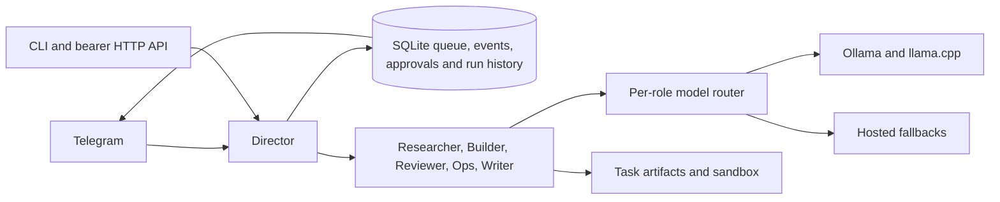

# Bot Team

Bot Team is a persistent single-operator Director service. Send a goal in Telegram, inspect it in Telegram or the CLI, and approve an exact proposed action when it needs your decision. The Director plans and validates a dependency graph, dispatches work to five configurable specialists, handles review and retries, and returns a final summary. It runs with Python 3.11+, SQLite, and a Docker sandbox.

## Run the five-bot demo

From the repository root, install the YAML parser and build the sandbox. The demo uses Docker for real code execution, requires a running Docker daemon, and uses a deterministic model adapter so it needs no LLM or Telegram credentials.

```sh
python3 -m venv .venv
. .venv/bin/activate
python -m pip install -r requirements.txt
docker build -t botteam-sandbox:local -f deploy/Sandbox.Dockerfile deploy
BOTTEAM_TEST_DOCKER=1 python -m unittest discover -s tests -v
```

The end-to-end test starts the HTTP service, uploads `examples/orders.csv`, and runs all five bots. The builder writes a Python program and executes it inside Docker. The reviewer independently computes the answer, the Ops step stops at an approval, and the test restarts the daemon before approving. The writer produces a report verifying **3 orders totaling 45.05**. A separate test rejects the approval and checks that there is no published copy.

For an interactive run, set the same `BOTTEAM_TOKEN` in both shells. Generate it with `python -c 'import secrets; print(secrets.token_hex(32))'`.

```sh
# Shell 1
export BOTTEAM_TOKEN='paste-your-random-token'
python -m botteam serve --offline --data data/demo
```

```sh
# Shell 2, with the same token and virtual environment
python -m botteam health
python -m botteam submit 'Calculate and verify the total for these orders' --demo --file examples/orders.csv
python -m botteam watch TASK_ID --until-input
python -m botteam show TASK_ID
python -m botteam approve APPROVAL_ID
python -m botteam watch TASK_ID
python -m botteam artifact TASK_ID steps/report/report.md
```

Use a separate data directory for live tasks. Offline mode uses the CSV demo plan for tasks with an `orders.csv` attachment.

## Set up Telegram

1. Create a bot with BotFather and keep the token in the service environment as `TELEGRAM_BOT_TOKEN`. Set `ALLOWED_USER_IDS` to your numeric Telegram user ID, or a comma-separated list for multiple authorized users. The process requires the allowlist whenever a token is configured.
2. Configure at least one usable route in `bots.yaml`. Start Ollama and pull the configured model, or provide the credential for a hosted fallback. Start the Director with `python -m botteam serve --data data/live`.
3. Open the bot’s private chat and send `/start`. Send a text goal, send a voice note, or upload a document and put the goal in its caption. Send documents without captions to stage up to 12 files for your next goal. Each task file is capped at 200 KB. `/clearfiles` clears your staged files.
4. For voice notes, set `OPENAI_API_KEY`. Speech is sent to OpenAI for transcription before planning, independently of task model routing. `TELEGRAM_TRANSCRIPTION_MODEL` defaults to `gpt-4o-mini-transcribe`. Set `TELEGRAM_VOICE_PER_HOUR=0` to disable voice. The defaults cap input at 8 requests an hour per user, 180 seconds and 12 MB per note. Transcription usage has its own limits and provider billing.

| Telegram command | Behavior |
| --- | --- |
| `/status [id]`, `/tasks`, `/bots` | Inspect the latest task, list tasks in this conversation, or see bot roles and model routes |
| `/pause [id]`, `/resume [id]` | Suspend or resume dispatch. Without an ID, apply to the latest active task |
| `/cancel <id>`, `/retry <id>` | Cancel dispatch or retry a failed task |
| `/logs [id]`, `/artifact <id> <path>` | Get the latest 40 events or download a specific artifact |
| `/answer <approval_id> <answer>` | Answer a clarification by ID |

Telegram accepts full task IDs and unambiguous prefixes of at least six characters. Approval messages show the proposed tool, exact arguments, and any destination or artifact hash. **Approve** executes the gate or prompts for a clarification reply. **Reject** closes the gate and fails the task. **Retry** is available after a failure. **View Logs** opens the event history. Telegram attaches output longer than 3,500 UTF-16 units as `.md` or `.txt`. It also attaches Markdown reports, text, and patches after completion.

Private chats are the default. For optional forum topics, set `TELEGRAM_FORUM_CHAT_IDS` to the approved numeric group IDs. Start a task in a topic to keep its approvals, artifacts, and final report in that thread. Set `TELEGRAM_BOT_TOPICS` to a JSON mapping such as `{"-1001234567890":{"builder":37,"reviewer":41}}` to send individual specialist updates to specific topics. Group members can see bot posts in that group. Telegram privacy mode may limit free-form messages in groups, so use a private chat or configure the group bot’s privacy setting for the intended workflow.

The gateway long-polls Telegram, persists incoming update and outgoing event cursors, and requires allowlist and task-ownership checks for messages and buttons. Submissions use Telegram update IDs for deduplication. A crash between sending a message and saving its cursor can repeat a notification. Use one long-polling process per bot token, with any existing webhook removed. `health` reports when polling has recently succeeded.

## Turn a GitHub issue into a draft PR

This workflow takes a real issue from one configured repository, prepares a tested patch, and hands the
draft PR link back to the dashboard and Telegram. The operator approves the reviewed patch before any
branch or pull request is created. Once approved, GitHub transport retries reuse the same branch and
recognize an existing matching draft.

1. In `bots.yaml`, set the existing `policy.github_repo` value to `owner/repo`.
2. Add a top-level `github_workflow` recipe for the parts of the repository Bot Team may work on.
3. Set `BOTTEAM_GITHUB_TOKEN` in the service's secret file. Prefer a fine-grained token limited to that
   repository, with Issues read, Contents read/write, and Pull requests read/write. Use live models and
   build an image with the required runtime and dependencies already installed.
4. Restart Bot Team and send `/issue 42` in your authorized Telegram chat, for example. From the CLI
   use `python -m botteam submit 42 --github-issue`. The authenticated API can submit
   `{"goal":"42","mode":"github_issue"}` to `POST /tasks`.

For the **issue #1 version-command pilot on the Bot Team VM**, use the setup helper from an
interactive SSH terminal. It prompts privately for the token, checks out the issue, applies the tested
recipe, and rolls back its configuration edits if the service fails its readiness check.

```sh
sudo /opt/bot-team/.venv/bin/python /opt/bot-team/deploy/configure-version-pilot.py
```

When setup reports readiness, send `/issue 1` in Telegram.

Example recipe for a small Python module, with names to replace for your repository:

```yaml
github_workflow:
  base: main
  paths: [app.py, tests/check_app.py]
  editable_paths: [app.py]
  test_paths: [tests/check_app.py]
  test_argv: [python, -m, unittest, discover, -s, tests, -p, check_app.py]
```

The recipe checks out a pinned snapshot of the exact listed text files. It supports up to 40 paths and
50 KB per source file. Editable paths are existing files included in the snapshot. Keep the regression
tests and their fixtures outside editable paths. The configured test command always runs in the
network-disabled Docker sandbox. The builder can fix test failures within its configured repair limit.
Add every import or fixture required by the test command to the snapshot.

At the draft approval, inspect `steps/review/proposed.diff` and `steps/review/tests.txt`. The approval
binds the branch, base commit, patch, and evidence. If the base branch moves before publishing a new
draft, submit the issue again so the new base can be tested and reviewed. The workflow concludes once
GitHub confirms the draft, and a person can review it and merge it through the repository's normal process.

## Configure models and bots

`bots.yaml` has four layers.

- **Providers** define a protocol, base URL, optional credential environment variable, request rate, timeout, and concurrent calls. Ollama uses its native chat API. llama.cpp and hosted providers use OpenAI-compatible chat APIs.
- **Models** map aliases to provider model IDs and per-million-token input and output prices. Each route has a `primary` alias followed by ordered `fallbacks`. The included routes start with local Ollama, then try enabled local or hosted fallbacks. The file includes Google AI Studio, Groq, OpenRouter, Mistral, and a paid OpenAI example.
- **Inference** defines global `context_length`, `keep_alive` in seconds, `temperature`, and per-role inference `concurrency`. A profile can override those four settings. Each provider also has its own concurrency limit. A specialist’s `slots` controls its assigned execution turns.
- **Bots** define `id`, `capabilities`, `persona`, `tools`, `slots`, and model route. The Director plans over the union of capabilities. The scheduler chooses a matching bot with an open slot, prioritizes normalized load and primary model price, and keeps the same bot on subsequent turns of a step.

To change a bot’s model, set its `primary` and `fallbacks`, then restart the service. To add a bot, append a record under `bots` and reuse a capability or introduce a new one. To add a tool, implement its server-side handler and contract before exposing it to a bot.

```yaml
  - id: technical_writer
    capabilities: [write, release_notes]
    primary: groq_free
    fallbacks: [local_general, gemini_free]
    inference: {context_length: 12288, keep_alive: 30, concurrency: 1, temperature: 0}
    slots: 1
    tools: [read, write]
    persona: Draft release notes based on verified changes and cite workspace paths.
```

Rate limits, timeouts, busy providers and unavailable models advance the route. Provider cooldown limits repeat calls after upstream errors. Exhausted transient routes use exponential retry. Before each request, SQLite atomically reserves estimated prompt tokens plus the maximum possible output, and checks task budgets and configured request-per-minute limits. Failed calls keep their reservations because a provider may have processed them. The default dollar budget is zero. Verify free-tier eligibility and pricing for the credential you supply, especially on billing-enabled projects, and set prices to match your account. For local-only processing, remove hosted aliases from every route, and leave hosted transcription disabled. Documents and scoped tool output can be sent to enabled hosted fallbacks.

### Local memory controls

- **Ollama.** Apply `deploy/ollama.env` to a dedicated server, then run `ollama pull qwen2.5:7b`. The sample enables Flash Attention with `q8_0` KV cache. Switch to `q4_0` if your installed version and hardware support it and the quality tradeoff is acceptable. The router sets `num_ctx`, `num_predict`, temperature and bounded `keep_alive`; a zero keep-alive requests immediate unload. Its resident model cap, local concurrency limit, and idle eviction complement Ollama’s server-side `OLLAMA_MAX_LOADED_MODELS` and `OLLAMA_NUM_PARALLEL`. Keep the server limits at least as strict as your available resources.
- **llama.cpp.** Set `MODEL_PATH` to a GGUF file, then start `deploy/llama-server.sh`. It defaults to one slot, 16,384 context, Flash Attention, and `q8_0` key and value cache. Override `LLAMA_CONTEXT_LENGTH`, `LLAMA_PARALLEL`, `LLAMA_FLASH_ATTENTION`, `LLAMA_CACHE_TYPE_K`, and `LLAMA_CACHE_TYPE_V` as needed. Set the provider’s `context_length` and `concurrency` to match the server. Enable `llamacpp` in YAML and select `local_gguf`. Its model stays resident while its server process is running. The router counts each enabled llama.cpp process against the configured residency limit, so running it alongside Ollama requires room for both.

Use a model that fits your memory budget at the selected context and concurrency. The configured limits bound admissions and KV use, with the model server and host responsible for actual RAM and VRAM limits. The worker prompt keeps role instructions and a task prefix stable across turns and sends bounded dependency outputs, recent observations, attachment paths, and task-scoped history. Parsing, DAG validation, file writes, diffs, hashing, and budget checks use deterministic code.

## Controls and guardrails

| Autonomy | Behavior |
| --- | --- |
| `safe` | Automatically reads, researches, drafts and runs sandbox tests. Requires approval for publication, integration posts, draft PRs, and bot-created schedules |
| `confirm_all` | Gates workspace writes, patch generation, and sandbox execution in addition to high-impact actions |
| `read_only` | Allows research, reads, and clarification. Disables mutating and execution tools |

Disable specific tools with `policy.disabled_tools`. Research uses Brave if `BRAVE_SEARCH_API_KEY` is present and Wikipedia otherwise. HTTPS fetches are restricted to exact `fetch_hosts`, with redirects disabled. Configure named HTTPS integrations under `policy.integrations` for authorized sends and deployments. Configure `policy.github_repo` and `BOTTEAM_GITHUB_TOKEN` for approved draft PRs from an existing branch in that repository. The builder can generate a unified patch for an uploaded original independently of GitHub.

External effects require approval and are never automatically replayed after an ambiguous send. Inspect the destination if a crash or transport failure leaves the result uncertain. Pause and cancel prevent future dispatch, but an already-running command or request can finish. Manual retry keeps completed steps, recorded model usage, and observations, and reopens unfinished work. The operator can create recurring jobs with `python -m botteam schedule 'goal' --every 3600`, inspect them with `schedules`, and stop new runs with `disable-schedule ID`. Missed intervals are coalesced into one run after downtime.

The Docker runner has networking disabled, a read-only root filesystem, no Linux capabilities, and an unprivileged user. It gets a bounded snapshot over stdin, without host mounts or service credentials, and executes inside a size-limited writable tmpfs. It limits pids, CPU, memory, stdout and runtime. Use the `write` and `patch` tools for durable outputs. The Director can serve multiple independent tasks concurrently, with one process owning a state directory. The API is a single-operator interface with a bearer token. Bind it to loopback or put it behind an authenticated TLS reverse proxy.

## Service and architecture

Install the repo under `/opt/bot-team`, create its `.venv`, provision the `botteam` service account and Docker access, and populate `/etc/botteam.env` from `deploy/botteam.env.example` with mode 0600. Install `deploy/botteam.service` in the systemd unit directory and run `systemctl enable --now botteam`. The unit restarts the daemon and persists data under `/var/lib/botteam`. The sample uses the Docker group. Docker daemon access is privileged, so keep the service account dedicated or use a separately configured rootless Docker daemon.



- `botteam/engine.py` manages the DAG and lifecycle. Steps move from queued to assigned and in progress. Approval gates use needs-review or blocked states, then work resumes, completes, or fails. A rejected QA verdict can rerun the builder with concrete feedback, up to the configured repair limit.
- `botteam/store.py` defines SQLite persistence and event logs. The `projects/<task-id>/` directory contains uploaded files, per-step artifacts, and approved copies.
- `botteam/models.py` defines Director, worker and final-review contracts. `routing.py` handles providers and local admission. `actions.py` implements workspace, Docker, and allowlisted HTTP tools.
- `botteam/telegram.py`, `api.py`, and `__main__.py` expose the interfaces. Use `python -m botteam --help` for CLI commands. The JSON API uses `/tasks`, `/tasks/{id}`, `/tasks/{id}/events`, `/tasks/{id}/artifacts/{path}`, `/approvals/{id}/approve`, and `/schedules`. Add `Authorization: Bearer <BOTTEAM_TOKEN>` except for `GET /healthz`. Submit attachments as a basename-to-Base64 JSON map. For local notification previews, `watch --desktop` uses `notify-send` if installed.

There is no service-side cleanup policy in this MVP. Back up the SQLite state and project artifacts together. The database contains task data, results, approvals, and Telegram intake metadata.

## Private browser workbench

The service includes an optional responsive workbench at `/ui/`. It uses the same Director, SQLite tasks, approvals, events and artifacts as Telegram and the CLI. There is no separate job engine. It supports text goals, file intake, job filters, step progress, exact approval arguments and hashes, clarification answers, pause/resume/cancel/retry, decision history, activity and artifact downloads.

Set a **separate**, vault-generated `BOTTEAM_WEB_PASSWORD` of at least 24 characters in the service environment. Never use the Director bearer token as the browser password. The workbench is disabled unless the password is set. The server holds the Director credential; it is not embedded in JavaScript or stored in browser storage. Browser sessions last eight hours and use HttpOnly, SameSite=Strict cookies, per-session CSRF tokens, same-origin POST checks, Host validation and a restrictive content-security policy. Sessions are intentionally invalidated on service restart. Login attempts are rate limited in process; this is a single-owner private tool, not a public identity service.

Keep the default loopback bind. Reach it through an SSH tunnel and open **http://127.0.0.1:8042/ui/** on your own computer. The hostname matters: the local Host check expects `127.0.0.1`, not `localhost`. For a separately secured TLS reverse proxy, set `BOTTEAM_WEB_ORIGIN` to its exact HTTPS origin. This enables Secure cookies. The proxy must preserve the public Host header and should enforce its own access controls and rate limiting. Do not put the service or Docker socket directly on the public internet. Do not reuse the workbench origin for untrusted content.

To receive messages for jobs created in the workbench, explicitly set `BOTTEAM_TELEGRAM_OWNER_ID` to your own allowlisted numeric Telegram user ID, after starting the bot's private chat. This links new dashboard jobs to that private chat, with the same Telegram ownership checks. No forum or group is inferred. Existing chat-created jobs already appear in the single-operator dashboard. Existing unlinked API/CLI tasks are not retroactively forwarded. Leaving the owner ID unset does not disable Telegram, but new dashboard tasks will not be forwarded there.

Approval decisions from either interface share the same durable record. A decision notification is sent to the linked chat; old Telegram buttons may remain visible but fail closed when pressed. The browser polls every five seconds while visible. A stale decision returns a conflict and refreshes instead of replaying the action. New browser submissions carry a durable idempotency key; unchanged retries after a lost response return the original job. Changing the content starts a new submission. Do not expect exactly-once Telegram message delivery across a crash; the existing transport limitation still applies.

The workbench follows service mode. In `--offline` mode, submit `examples/orders.csv` with a goal to use the existing deterministic five-role demo. This still needs the Docker sandbox. In live mode, tasks use the configured routes, policies and budget. Free-labelled routes are not proof of free billing, and voice transcription is billed separately unless disabled. No credentials or model access are provisioned by the workbench.

Validation: `python -m unittest discover -s tests -v` includes HTTP/session/CSRF/Host tests, concurrent/restarted submission deduplication, real SQLite cross-channel approvals, unauthorized Telegram denial, stale decisions, clarification and artifact path checks. A deterministic write-and-approve lifecycle test runs without external model calls or Telegram sends. Docker-dependent end-to-end tests remain opt-in with `BOTTEAM_TEST_DOCKER=1`; run those on the target host before relying on code execution. The browser uses no third-party scripts, fonts or packages.
